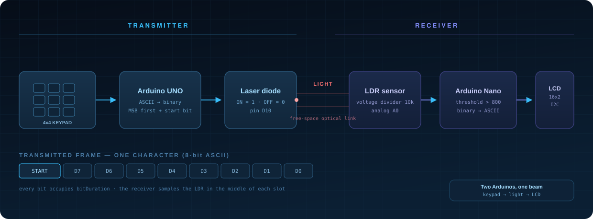
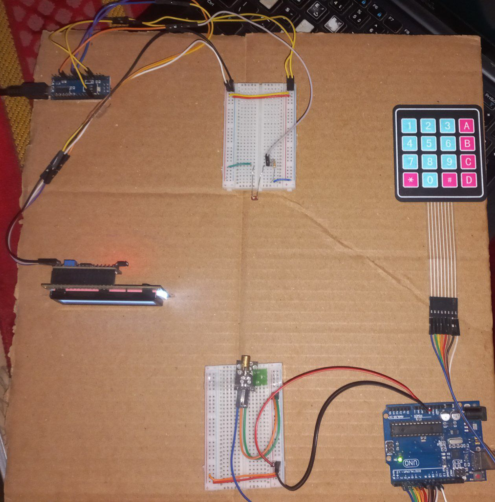

<div align="center">

# 💡 Li-Fi Communication System

### Sending text through a laser beam — Arduino transmitter → free-space light → Arduino receiver


<sub>A course project for <b>Electrical Measurements</b> — supervised by <b>Dr. Mohamed Khamees</b></sub>

</div>

---

## 📖 Overview

**Li-Fi** (Light Fidelity) is a wireless communication technology that carries data on **light** instead of radio waves. Because light does not pass through walls, the link is confined to the room it is generated in — which is exactly what makes it attractive for secure, interference-free environments such as hospitals and aircraft cabins.

This project is a working, end-to-end implementation of that idea at the smallest useful scale:

> **A keypad on one Arduino modulates a laser diode. An LDR on a second Arduino reads the beam and prints the recovered character on an LCD.**

No radio, no Wi-Fi, no cables between the two sides — only a beam of light.



---

## 🔬 How it works

### Transmitter side

1. You press a key on the **4×4 keypad**.
2. The Arduino UNO converts the character to its **8-bit ASCII** value.
3. It sends a **frame**: one *start bit* (laser ON) followed by the 8 data bits, **MSB first**.
4. Each bit is held for `bitDuration` milliseconds — laser **ON = 1**, laser **OFF = 0**.

```
frame for 'A'  (ASCII 0x41 = 0100 0001, MSB first)

 START   D7  D6  D5  D4  D3  D2  D1  D0
   1      0   1   0   0   0   0   0   1
   ‾‾|____|‾‾‾|____|____|____|____|____|‾‾‾
```

### Receiver side

5. The **LDR + 10 kΩ resistor** form a voltage divider, so light intensity becomes a voltage on **A0**.
6. The Arduino Nano compares the reading against a **threshold** (800 in this build): brighter → `1`, darker → `0`.
7. When it sees the start bit, it samples the next 8 slots and rebuilds the byte.
8. The decoded character is printed on the **Serial Monitor** and on the **16×2 I²C LCD**.

| Frame field | Length | Purpose |
| :--- | :--- | :--- |
| **Start bit** | 1 bit | Laser ON — tells the receiver a character is starting |
| **Data bits** | 8 bits | ASCII code, transmitted MSB first |
| **Gap** | variable | Laser held OFF between characters |

---

## 🧰 Hardware

| Side | Component | Role |
| :--- | :--- | :--- |
| **TX** | Arduino UNO | Reads the keypad, converts characters to bits, drives the laser |
| **TX** | 4×4 matrix keypad | Manual text input (pins D2–D9) |
| **TX** | Laser diode / module | The transmission medium — switched ON/OFF per bit (pin D10) |
| **TX** | Resistors, breadboard, jumpers | Current limiting and wiring |
| **RX** | Arduino Nano | Samples the LDR, decodes bits back to characters |
| **RX** | LDR | Detects the incoming light intensity |
| **RX** | 10 kΩ resistor | Voltage divider — turns LDR resistance into a readable voltage |
| **RX** | LCD 16×2 with I²C backpack | Displays the received text (address `0x27`) |

---

## 📂 Repository layout

```text
lifi-communication-system/
├── firmware/
│   ├── transmitter/transmitter.ino   # keypad → ASCII → laser frames
│   └── receiver/receiver.ino         # LDR → bits → ASCII → LCD
├── assets/
│   ├── block-diagram.svg             # system diagram
│   ├── hardware-setup.jpg            # the actual breadboard prototype
│   └── demo.mp4                      # recorded demonstration
├── docs/
│   └── Li-Fi-Presentation.pptx       # full project presentation & component analysis
└── README.md
```

---

## 🚀 Getting started

**Requirements:** [Arduino IDE](https://www.arduino.cc/en/software) 1.8+ or 2.x, plus two libraries installable from *Library Manager*:

- **Keypad** — Mark Stanley & Alexander Brevig
- **LiquidCrystal_I2C** — Frank de Brabander

**Flash the transmitter**

```text
Open firmware/transmitter/transmitter.ino
Board: Arduino UNO      Port: your COM port      →  Upload
```

**Flash the receiver**

```text
Open firmware/receiver/receiver.ino
Board: Arduino Nano     Processor: ATmega328P (Old Bootloader if needed)
Port: your COM port     →  Upload
```

**Run it**

1. Power both boards (USB or a 9 V battery).
2. Point the laser straight at the LDR, about 20–50 cm away.
3. Keep the room lighting stable, then open the receiver's Serial Monitor at **9600 baud**.
4. Press a key on the keypad — the character appears on the LCD and in the Serial Monitor.

### Tuning

| Symptom | Fix |
| :--- | :--- |
| Nothing decodes | Read the receiver's `LDR Voltage` line and move `threshold` between the dark and lit values |
| Wrong characters | `bitDuration` in the two sketches must match exactly — increase both for longer, more reliable frames |
| Works only very close | Align the beam more precisely, or reduce ambient light on the LDR |
| Random characters appear | Ambient light / reflections tripping the start bit — shield the LDR or raise `threshold` |

---

## 📸 Demo

<div align="center">
  <a href="assets/demo.mp4">
    
  </a>
  <br/>
  <sub>▶ Click the photo to watch the recorded demo — <a href="assets/demo.mp4">assets/demo.mp4</a></sub>
</div>

The prototype is built on cardboard: keypad and laser on the transmitter half, LDR aligned with the beam, and the LCD showing the decoded character on the receiver half.

---

## ⚠️ Known limitations

- **One character per key press** in the bundled sketches — the presentation in `docs/` describes an extended design with message buffering, `#` to send, and serial-monitor input.
- **No clock recovery or checksum.** Decoding relies on both sides using the same `bitDuration`; a single missed bit corrupts the character.
- **Ambient light sensitivity.** The fixed `threshold` needs re-calibration when the room lighting changes.
- **Line of sight only.** The beam must stay on the LDR — that is the security advantage and the practical weakness of Li-Fi at the same time.

---

## 👥 Team

| # | Name | Role |
| :---: | :--- | :--- |
| 1 | **Ahmed Hatem Abou Elghait** | Team leader |
| 2 | Ebrahim Hamdy Khalaf | Team member |
| 3 | Ahmed Hamada Ahmed | Team member |
| 4 | Ahmed Safwat Zakaria | Team member |
| 5 | Hesham Ahmed Abou Elfotouh | Team member |
| 6 | Saif Alaa Eldein Elsayed | Team member |
| 7 | Ahmed Abd Elaziem Mohamed | Team member |
| 8 | Mohamed Yasser Farouq | Team member |
| 9 | Mohamed Karam Anwar | Team member |
| 10 | Ahmed Yasser | Team member |

---

## 📫 Contact

- **GitHub** — [@ahhhatem500-cmd](https://github.com/ahhhatem500-cmd)
- **LinkedIn** — [Ahmed Hatem](https://www.linkedin.com/in/ahmed-hatem-5674a7391)
- **Telegram** — [@Eng_Ahmed_Hatem1030](https://t.me/Eng_Ahmed_Hatem1030)
- **Email** — [ahhhatem500@gmail.com](mailto:ahhhatem500@gmail.com)

---

<div align="center">
<sub>Built with two Arduinos, a laser, and a lot of cardboard.</sub>
</div>
